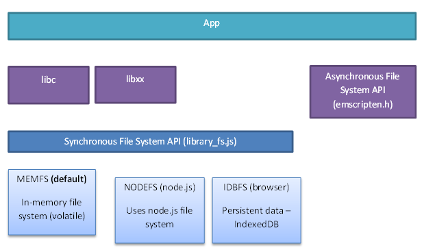

# 前言

主要为[C/C++面向WebAssembly编程](https://github.com/3dgen/cppwasm-book)内容简要提炼，以及自身理解实践补充等

# 基本知识

前提：本地准备好`Emscripten`，然后在当前命令行执行`/path/to/emsdk_env.bat`，将emsdk的各个路径添加到当前命令行的环境变量

## 基础代码编写

### js中调用c

wasm文件与javascript文件的交互可通过导出函数实现，导出函数需要给相应函数添加修饰符，这个修饰符在c++/c编译场景下是不同的，因此可通过条件编译探测环境并声明对应的宏。**(main函数为例外，main函数不需要添加修饰符，默认导出为`_main`方法，并且若文件中有main函数，wasm加载时会自动执行一次)**

```c++
#ifndef EM_PORT_API
#	if defined(__EMSCRIPTEN__)
#		include <emscripten.h>
#		if defined(__cplusplus)
#			define EM_PORT_API(rettype) extern "C" rettype EMSCRIPTEN_KEEPALIVE
#		else
#			define EM_PORT_API(rettype) rettype EMSCRIPTEN_KEEPALIVE
#		endif
#	else
#		if defined(__cplusplus)
#			define EM_PORT_API(rettype) extern "C" rettype
#		else
#			define EM_PORT_API(rettype) rettype
#		endif
#	endif
#endif
```

假设有一个`HelloWorld.cc`文件，暴露了一个`EM_PORT_API(int) plus_one(int)`函数，那么编译命令如下

```bash
emcc HelloWorld.cc -o HelloWorld.js
```

该编译命令在编译成功后会生成一个胶水js代码文件，以及一个wasm文件，通过引入胶水js，可以自动载入wasm模块

需要调用时在你自身的html中实现如下

```
<!DOCTYPE html>
<html lang="en">
    <head>
        <meta charset="UTF-8" />
        <title>Document</title>
    </head>
    <body>
        <script>
            Module = window.Module || {};
            Module.onRuntimeInitialized = function () {
                console.log("result: ", Module._plus_one());
            };
        </script>
        <script src="HelloWorld.js" async type="text/javascript"></script>
    </body>
</html>
```

你会看到，控制台输出结果为`result: 1`

### js中实现c函数

可以在c文件中声明函数，在js文件中实现，编译时通过emcc命令链接js文件

如下为参考资料中给出的示例

__声明__

```c++
#include <em_export.h>

EM_PORT_API(int) js_add(int a, int b);
EM_PORT_API(int) js_console(int value);

EM_PORT_API(void) print_the_answer(int a, int b)
{
    int ret = js_add(a, b);
    js_console(ret);
}
```

__实现文件__

```javascript
mergeInto(LibraryManager.library, {
    // 注如下不能用es6的缩略写法，否则不被编译器识别
    js_add: function (a, b) {
        console.log(a + b);
        return a + b;
    },
    js_console: function (value) {
        console.log("The answer is: " + value);
    },
});
```

__编译命令__

```bash
emcc HelloWorld\merge.cc --js-library HelloWorld\merge.js -Iinclude -o merge.html
```

## 单向透明内存模型

wasm代码运行时使用的内存实际上对应的是js运行环境中的ArrayBuffer，内存地址就是ArrayBuffer的字节索引，javascript代码可以通过`Module.HEAP[U|F]{8|16|32|64}`来访问wasm运行时的内存，但是wasm代码内部无法访问外部js环境的内存

### js与c/c++内存交换

__参数及返回值__

js与c数据交换只能通过Number类型（数字、指针地址等）进行，示例如下

```javascript
const DataTransport = {
    transportByNumber() {
        console.log(Module._increase_number(1));
    },
};
```

```c
#include <em_export.h>
#include <stdio.h>
#include <stdlib.h>

EM_PORT_API(int) increase_number(int in) {
    return in + 1;
}
```

__直接操作内存__

```c
#include <em_export.h>
#include <stdio.h>
#include <stdlib.h>

static int value = 123;

EM_PORT_API(int *) get_value_address() {
    // 全局变量存在堆上
    return &value;
}

EM_PORT_API(int) get_pointer_data(int *pointer) {
    return *pointer;
}
```

```javascript
const DataTransport = {
    transportByAddress() {
        const ptr = Module._get_value_address();
        
        // 根据地址从堆上取值
        const value = Module.HEAP32[ptr >> 2];
        console.log(value);
    },
    allocMemoryInJs() {
        // 调用malloc需要使用编译选项导出malloc
        const ptr = Module._malloc(4);
        
        // 修改堆内存
        Module.HEAP32[ptr >> 2] = 12345;
        console.log(Module._get_pointer_data(ptr));
        
        // 记得释放
        Module._free(ptr);
    },
};
```

```bash
emcc HelloWorld\dataTransport.cc -Iinclude -o transport.html -s EXPORTED_FUNCTIONS=["_malloc", "_free"]
```

__字符串简易操作__

```javascript
const DataTransport = {
    stringTransPort() {
        // 需要导出了malloc
        const ptr = allocateUTF8("你好，Emscripten！");
        Module._print_string(ptr);
        
        // 较早版本为Pointer_stringify
        const str = UTF8ToString(Module._get_string());
        console.log(str);
    },
};
```

```c
#include <em_export.h>
#include <stdio.h>
#include <stdlib.h>

EM_PORT_API(void) print_string(char *ptr) {
    printf("%s\n", ptr);
}

EM_PORT_API(const char *) get_string() {
    return "test string";
}
```

## EM_ASM系列宏

可以通过EM_ASM系列宏在c代码中嵌入js，该宏展开后第一个逗号前的内容会作为字符串

```c
#include <emscripten.h>
#include <stdio.h>

int main() {
    int number = 123456;

    // 无返回值
    EM_ASM(console.log(123);console.log(456););
    
    //返回int类型，有参，需要用花括号包裹
    int result1 = EM_ASM_({
        console.log('EM_ASM_ arg0:', $0);
        console.log('EM_ASM_ arg1:', $1);
    }, number, 123);
    printf("result1: %d\n", result1);

    //返回double类型，有参，需要用花括号包裹
    double result2 = EM_ASM_DOUBLE({
        console.log("EM_ASM_DOUBLE arg0:", $0);
        console.log('EM_ASM_DOUBLE arg1:', $1);
    }, number, 123);
    printf("result2: %f\n", result2);
    
    //返回int类型，无参，不需要用花括号包裹
    int result3 = EM_ASM_INT_V(
        console.log('EM_ASM_INT_V');
        return 1;
    );
    printf("result3: %d\n", result3);

    //返回double类型，无参，不需要用花括号包裹
    EM_ASM_DOUBLE_V(
        console.log("EM_ASM_DOUBLE_V");
    );
}
```

## emscripten_run_script*

可以通过`emscripten_run_script`执行模板字符串

```c++
#include <stdio.h>
#include <emscripten.h>

int main() {
    // 该函数的参数会被传入eval执行
    emscripten_run_script("\
    console.log('asdsa');\
    console.log('asdsasdasa');\
    ");

    const char* str = emscripten_run_script_string("\
    function get_string() {\
        return 'get string result';\
    }\
    get_string();\
    ");

    const int value = emscripten_run_script_int("\
    function get_int() {\
        return 12345678;\
    }\
    get_int();\
    ");
    printf("%s %d\n", str, value);
    return 0;
}
```

## ccall/cwrap

js调用c函数时，若需要传递数字、字符串时，简化的调用方法

c示例

```c++
#include <stdio.h>
#include <emscripten.h>
#include <em_export.h>

EM_PORT_API(void) em_func_test_c_call_c_wrap(uint8_t *nums, const char *str, int count) {
    printf("%s: ", str);
    for (int i = 0; i < count; i++) {
        printf("%d\n", nums[i]);
    }
}
```

js中的调用示例

```javascript
function callWithCCall() {
    const nums = new Int32Array([1, 2, 3, 4]);
    Module.ccall(
        "em_func_test_c_call_c_wrap",
        "null",
        ["array", "string", "number"],
        [nums, "values is: ", nums.length]
    );

    // 类似bind、柯里化
    const func = Module.cwrap("em_func_test_c_call_c_wrap", "null", ["array", "string", "number"]);
    func(nums, "values is: ", nums.length);
}
```

编译命令

```bash
emcc HelloWorld\c_call.cc -Iinclude -s"EXTRA_EXPORTED_RUNTIME_METHODS=['ccall', 'cwrap']" -o cCall.html
```

## 消息循环

由于js中为单线程，因此若在c/c++编写无限循环，并在js中调用，会导致线程被阻塞，因此需要额外的机制实现主循环之类的逻辑

### `emscripten_set_main_loop`

函数声明：

`void emscripten_set_main_loop(em_callback_func func, int fps, int simulate_infinite_loop)`

参数：

- `func`：消息处理回调函数。
- `fps`：消息循环的执行帧率。如果该参数小等于0，则使用页面的`requestAnimationFrame`机制调用消息处理函数，该机制可以确保页面刷新率与显示器刷新率对齐，对于需要执行图形渲染任务的程序，使用该机制可以得到平滑的渲染速度。
- `simulate_infinite_loop`：是否模拟“无限循环”，是的话，循环后面的函数不会执行（注：永远不会执行，即使调用了emscripten_cancel_main_loop），并且循环期间main函数的调用栈不会销毁。

返回值：

- 无

### 其他循环控制函数

```c++
void emscripten_pause_main_loop(void)
void emscripten_resume_main_loop(void)
void emscripten_cancel_main_loop(void)
```

### 示例

```c++
#include <emscripten.h>
#include <em_export.h>
#include <stdio.h>

void loop_body() {
    static int index = 0;
    printf("%d\n", index++);
}

EM_PORT_API(void) pause_main_loop() {
    emscripten_pause_main_loop();
}

EM_PORT_API(void) resume_main_loop() {
    emscripten_resume_main_loop();
}

EM_PORT_API(void) cancel_main_loop() {
    emscripten_cancel_main_loop();
}

int main() {
    printf("loop start.\n");
    emscripten_set_main_loop(loop_body, 0, 1);
    printf("loop end.\n");
}
```

**编译命令**

`emcc HelloWorld\main_loop.cc -o mainLoop.html -Iinclude`

## 文件系统

Emscripten虚拟文件系统架构如下图：

[](https://img.cntofu.com/book/cppwasm-book/zh/ch3-runtime/images/03-fs-arch.png)

> **tips** 异步文件系统API是一组声明于emscripten.h中的函数，只能在Emscripten环境下使用，不符合本书“编译目标不敏感”的理念，故不予介绍。

在最底层，Emscripten提供了三种文件系统，分别为：

1. `MEMFS`：内存文件系统。该系统的数据完全存储于内存中，程序运行时写入的数据在页面刷新或程序重载后将丢失；
2. `NODEFS`：Node.js文件系统。该系统可以访问本地文件系统，可以持久化存储，但只能用于Node.js环境；
3. `IDBFS`：IndexedDB文件系统。该系统基于浏览器的IndexedDB对象，可以持久化存储，但只能用于浏览器环境。

### MEMFS文件系统

分为两种模式，embed和preload，分别由`--embed-file`和`--preload-file`两个参数控制，主要关注preload模式

#### preload

preload文件可以在编译时生成也可以通过`file_packager.py`生成

示例

```c
#include <em_export.h>
#include <stdio.h>
#include <stdlib.h>

const char* readFileContent(const char* filePath) {
    char* fileContent = NULL;
    FILE* fp = fopen(filePath, "rb");
    if (fp) {
        fseek(fp, 0, SEEK_END);
        long fileSize = ftell(fp);
        fseek(fp, 0, SEEK_SET);
        printf("file size: %ld\n", fileSize);
        fileContent = new char[fileSize + 1];
        // fscanf(fp, "%s", fileContent);
        // +1为结束符占一个字节大小，不设只能读出fileSize-1个字符
        fgets(fileContent, fileSize + 1, fp);
    } else {
        printf("read file failed! file path: %s\n", filePath);
    }
    return fileContent;
}

void deleteFileContent(const char* content) {
    delete content;
}

int main() {
    const char* content = readFileContent("HelloWorld/file_dir/file1.txt");
    printf("%s\n", content);
    deleteFileContent(content);
    return 0;
}
```

**编译方法1：编译的同时生成fileRead.data文件**

```bash
emcc HelloWorld\file_read.cc -o fileRead.html -Iinclude --preload-file HelloWorld\file_dir
```

**编译方法2：分别生成**

```bash
# 第一步：生成文件夹数据
D:\environment\emsdk\upstream\emscripten\tools\file_packager.bat fp.data --preload HelloWorld\file_dir --js-output=fp.js

# 第二步：生成wasm并且设置启用文件系统，并且在输出的html前添加fp.js载入文件数据
emcc HelloWorld\file_read.cc -o fileRead.html -Iinclude -s FORCE_FILESYSTEM --pre-js fp.js
```

## 内存管理

emscripten默认内存`16MB`，默认栈大小`5MB`

可以在编译时通过`-s TOTAL_MEMORY=xxxx`参数修改默认的初始内存，以及`-s TOTAL_STACK=xxxx`设置初始栈大小

> 由于WebAssembly内存单位为页，1页=64KB，因此当编译目标为`wasm`时，`TOTAL_MEMORY`必须为64KB的整数倍。

也可以在初始化wasm程序时通过配置参数设置初始内存

另外可通过`-s ALLOW_MEMORY_GROWTH=1`，启用动态内存，可使wasm初始内存不足时，malloc申请内存会自动扩大wasm程序被分配的内存。

emscripten提供了两种内存分配器`dlmalloc`,`emmalloc`，编译时可通过`-s MALLOC=xxxx`参数修改

> **tips** dlmalloc生成的代码体积大于emmalloc，除非对于代码体积极度敏感的场合，使用默认的`dlmalloc`内存分配器无疑是更优的选择。

## 补充说明

> JavaScript与C相互调用时的执行代价很高。虽然WebAssembly拥有接近于本地代码的执行性能，但倘若函数接口设计不合理、跨语言调用频率过高，整体运行效率会受到极大的拖累。

> 查阅Emscripten生成的胶水代码是了解C与JavaScript互操作时内部处理流程最直接的途径。

## 编译命令

> 由于内部调用`Clang`，因此`emcc`支持绝大多数的`Clang`编译选项，比如`-s OPTIONS=VALUE`、`-O`、`-g`等。除此之外，为了适应Web环境，`emcc`增加了一些特有的选项，如`--pre-js <file>`、`--post-js <file>`等。

### 常用参数及作用

#### `-s NO_EXIT_RUNTIME=[0|1]`

wasm文件里的main函数执行完毕后，运行时是否还存在

> 自Emscripten v1.37.26开始，`NO_EXIT_RUNTIME`默认为1

#### `--pre-js`

在胶水代码前插入一些js代码

#### `--post-js`

在胶水代码后插入一些代码

#### `-s"EXPORTED_FUNCTIONS=['xxxx', 'xxxx']"`

指定暴露出的函数模块

#### ` -s"EXTRA_EXPORTED_RUNTIME_METHODS=['xxxx', 'xxxx']"`

启用一些emscripten内置方法

#### `--embed-file`

指定以`embbed`模式加载的文件数据

#### `--preload-file`

指定以`preload`模式加载的文件数据

#### `-sFORCE_FILESYSTEM`

启用文件系统

#### `-sTOTAL_MEMORY=xxxx`，`-sTOTAL_STACK=xxxx`

指定内存大小和栈大小

#### `-sMALLOC=xxxx`

指定内存分配模式

#### `-sALLOW_MEMORY_GROWTH`

启用可变内存大小

# emcmake

## 尝试编译assimp

本来以为会很难，但是根据[官网](https://emscripten.org/docs/compiling/Building-Projects.html#integrating-with-a-build-system)的描述，这个编译按理说和不通过emscripten编译过程是一样的，因此直接尝试了一下，发现确实如此。

编译步骤如下

**1. 通过emcmake 生成makefile**

```bash
emcmake cmake -S . -B ./em_build -G "MinGW Makefiles"
```

**2. 进入em_build文件夹，直接执行emmake**

这个执行过程会提示一个警告说启用了`BUILD_SHARED_LIBRARY`，当前平台不支持动态库，默认编译静态库。

这个和官网说的差不多，就算用shared命令编译出来也是相当于静态库

> By default, when the -shared flag is used to build a shared library, Emscripten will produce an `.so` library that is actually just a regular `.o` object file (Under the hood it uses ld -r to combine objects into a single larger object). When these faux “shared libraries” are linked into your application they are effectively linked as static libraries. When building these shared libraries *Emcc* will ignore other shared libraries on the command line. This is to ensure that the same dynamic library is not linked multiple times in intermediate build stages, which would result in duplicate symbol errors.

**3. 测试验证静态库编译成功**

测试代码

```c
#include <assimp/Importer.hpp>
#include <assimp/scene.h>
#include <assimp/postprocess.h>
#include <iostream>

void loadModel(const char* model_path) {
    std::cout << "start importer" << std::endl;
    Assimp::Importer importer;
    const aiScene *scene = importer.ReadFile(model_path, aiProcess_Triangulate | aiProcess_FlipUVs);
    if (!scene || scene->mFlags & AI_SCENE_FLAGS_INCOMPLETE || !scene->mRootNode)
    {
        std::cout << "ERROR::ASSIMP::" << importer.GetErrorString() << std::endl;
        return;
    }
    std::cout << "start node processor" << std::endl;
    // std::cout << scene->mNumMeshes << std::endl;
}

int main() {
    loadModel("模型文件");
    return 0;
}
```

编译命令

```bash
emcc HelloWorld\load_model.cc -ID:\environment\libs\assimp-5.3.1\assimp-5.3.1\build\include -ID:\environment\libs\assimp-5.3.1\assimp-5.3.1\include -o loadModal.html -LD:\environment\libs\assimp-5.3.1\assimp-5.3.1\em_build\lib -lassimp -LD:\environment\libs\assimp-5.3.1\assimp-5.3.1\em_build\contrib\zlib -lzlibstatic
```

结果，虽然文件读取失败，但至少说明代码运行成功


# 性能对比

# 参考

[1.Guide for C/C++ developers](https://www.wasm.com.cn/docs/c-and-c++/)

[2.JavaScript调用C函数](https://www.cntofu.com/book/150/zh/ch2-c-js/ch2-01-js-call-c.md)

[3. C/C++面向WebAssembly编程](https://github.com/3dgen/cppwasm-book#cc%E9%9D%A2%E5%90%91webassembly%E7%BC%96%E7%A8%8B)

[4.emscripten官方文档](https://emscripten.org/docs/compiling/Building-Projects.html#integrating-with-a-build-system)